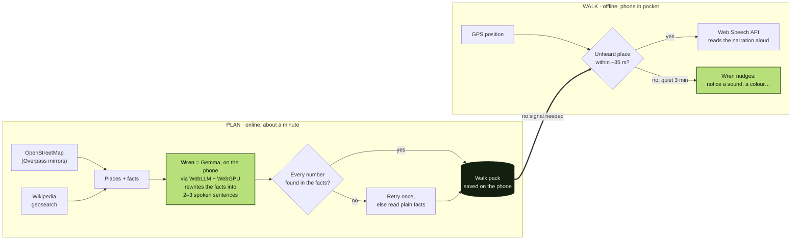

# Earshot

**A walking guide that lives in your pocket.**

Plan a walk while you have Wi-Fi. Earshot finds the interesting corners around you on OpenStreetMap and Wikipedia, and **Wren**, your pocket guide, writes a short spoken piece about each one. Wren is Google's open-weight **Gemma** model, running entirely on your own device. Then the phone goes in your pocket. When GPS says you've reached a place, Earshot speaks up in your earbuds. In the quiet stretches between places it nudges you to notice things: a sound, a colour, the sky.

The screen is the shortest part of the walk.

## How it works



- **Wren, the persona:** the app never shows model names. People meet Wren, a friendly companion who introduces itself, narrates each stop, and nudges you to notice things between stops. Settings offer "Full" or "Light" storytelling instead of model IDs.
- **Models (swappable):** [Gemma 2 2B Instruct](https://huggingface.co/mlc-ai/gemma-2-2b-it-q4f16_1-MLC) by default, or [Gemma 3 1B Instruct](https://huggingface.co/mlc-ai/gemma3-1b-it-q4f16_1-MLC) as a lite option, both via [WebLLM](https://github.com/mlc-ai/web-llm) on WebGPU. f32 builds are used on GPUs without `shader-f16`. With no WebGPU at all, Earshot reads the facts plainly.
- **Grounding:** Gemma is asked to *rewrite* the OSM tags and Wikipedia intro, not to recall anything. Any number it says (years, heights) must appear in the source text. Otherwise it retries at low temperature, then falls back to the plain facts. Places with no facts get a "tell them what to look at" prompt instead. Every narration ends with a small physical action: look, touch, listen.
- **Short prompts on purpose:** Gemma 3 1B attends over a 512-token sliding window. Long prompts with rules and worked examples made it invent things ("the museum of the Great Pyramid"). Short "rewrite these facts" prompts fixed it.
- **Privacy:** the live GPS trace never leaves the device. While planning, only a coarse (~100 m) point is sent to OpenStreetMap and Wikipedia.
- **Offline:** narration is generated at planning time, so the walk needs no network and no model. A service worker caches the app shell. Gemma's weights are cached by WebLLM after the first download (1.5 GB or 540 MB), falling back from Cache Storage to IndexedDB if the browser refuses large entries.
- **Resilient data:** public Overpass servers are flaky, so several mirrors are queried in parallel alongside Wikipedia's geosearch. Places mapped twice under slightly different names are merged, and OSM→Wikipedia links pointing more than 2 km away are ignored.
- **Pocket mode:** mobile browsers pause GPS when the screen sleeps, so Earshot holds a Wake Lock and shows an all-black screen (cheap on OLED, invisible in a pocket).

## Run it

```bash
npm install
npm run dev
```

Open http://localhost:5173 in Chrome or Edge (desktop), or Chrome on Android 12+. Geolocation and WebGPU need `localhost` or HTTPS.

**No time to go outside?** After planning, tap **Preview it from here**. It fast-forwards a stroll past every place so you can hear the whole thing at your desk.

## Build

```bash
npm run build   # static site in dist/, deployable anywhere (GitHub Pages, Render, ...)
```

## Credits

- Map data © [OpenStreetMap](https://www.openstreetmap.org/copyright) contributors, ODbL.
- Place summaries from [Wikipedia](https://en.wikipedia.org), CC BY-SA.
- [Gemma](https://ai.google.dev/gemma) open-weight models by Google, under the Gemma Terms of Use.
- [WebLLM](https://github.com/mlc-ai/web-llm) by MLC, Apache-2.0.

## License

MIT
